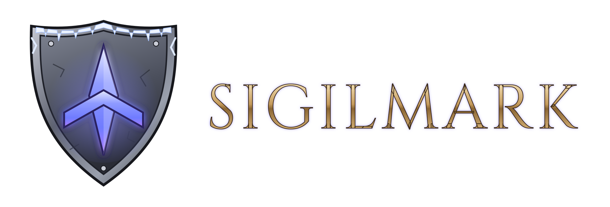
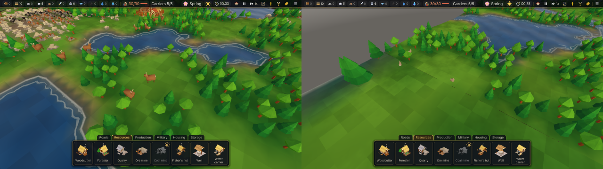
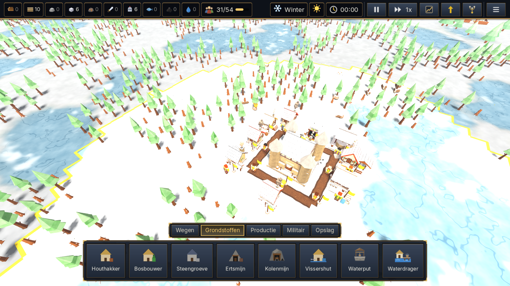
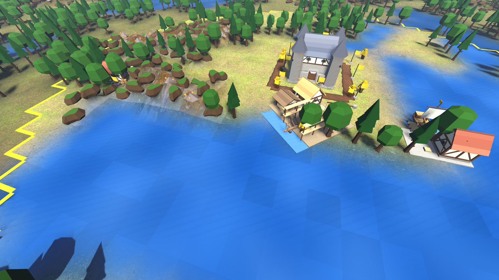
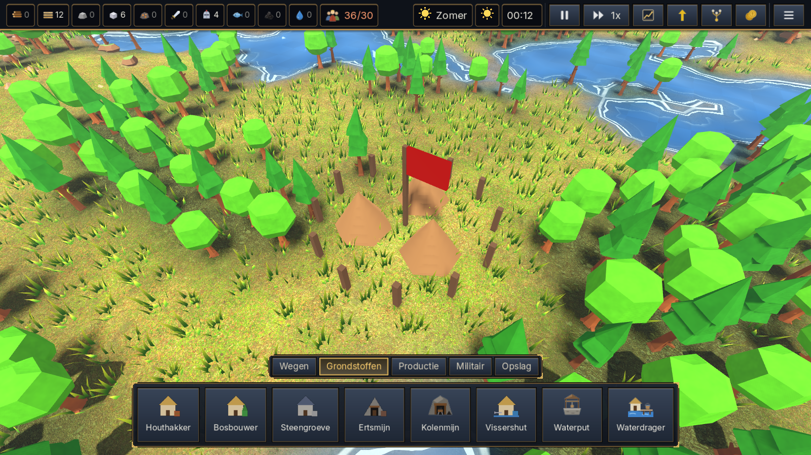

  

<h1 align="center">Kolonie — in de wereld van Sigilmark</h1>

  
  
  
  

> Sigilmark is een rustig maar scherp bouwspel. De Kroon van Ostrevaal is gebroken en het land is van niemand. Jij leidt Huis van de Eerste Kerf: leg wegen, bouw daken en merk je grenzen met het sigil. Ondertussen trotseer je rovers, rivaliserende huizen en winters die tanden hebben. *Eerst een dak, dan een droom.*

**Kolonie** is een trage, ketengebaseerde economie- en bouwgame in de geest van *De Kolonisten (Die Siedler)*, gemaakt in Godot 4 door LTGnetwork (België). Gratis te downloaden voor Windows.

**[⬇ Download de nieuwste versie](https://github.com/LTGmaster/kolonie-releases/releases/latest)** · [Wat is er nieuw](CHANGELOG.md) · [Roadmap](ROADMAP.md) · [English](#english)

---

## Kenmerken
- **Kolonisten en dragers** — elk goed wordt echt gedragen, van vlag tot vlag. Dragers en depots houden je logistiek draaiende.
- **Wegen** — zonder weg kan het ook, maar wegen (aarde → kasseien → verhard) maken je dragers flink sneller.
- **Woningen met behoeften** — huizen hebben water, voedsel en warmte nodig; tekort betekent vertrekkende kolonisten.
- **Productieketens** — houthakker, zagerij, visser, mijnen, smeden en meer.
- **Techboom** — onderzoek productie, opslag, kasseien, scheepvaart, ridders, …
- **Seizoenen en winter** — de winter heeft tanden: plan je voorraad.
- **Rivieren, overstromingen en dijken** — water is leven, maar ook gevaar.
- **Schepen** — verken en vervoer over het water.
- **Roverskampen** en **AI-tegenstanders** — rivaliserende huizen met dezelfde regels als jij, geen valsspelen.
- **Wilde dieren** (nieuw in 0.19.1) — kuddes herten, konijnen en zwijnen die grazen, zwerven en vluchten.
- **Automatisch opslaan**, quicksave/quickload.
- **Nederlands en Engels** in het spel.

## Screenshots
<!-- Plaats voor extra screenshots/gif (docs/screenshot_*.png of docs/*.gif) -->
| | |
|---|---|
|  |  |
| *Wilde dieren (0.19.1)* | *Winter* |
|  |  |
| *Schepen* | *Roverskampen* |

## Downloaden en installeren
1. Ga naar de [nieuwste release](https://github.com/LTGmaster/kolonie-releases/releases/latest) en download `Kolonie-x.y.z-Setup.exe`.
2. Start de Setup en volg de stappen. Een nieuwe versie installeer je gewoon over de oude heen; je saves blijven bewaard.
3. **Windows SmartScreen**: de installer is (nog) niet digitaal ondertekend, dus Windows kan "Windows heeft uw pc beschermd" tonen. Klik op *Meer info* → *Toch uitvoeren*. Download Kolonie alleen via deze pagina.

### Systeemvereisten
- Windows 10 of 11 (64-bit)
- Een videokaart met Vulkan-ondersteuning (de meeste kaarten van de laatste jaren); grafische kwaliteit (Laag/Middel/Hoog) is instelbaar
- Toetsenbord en muis

## Besturing
| Actie | Toets |
|---|---|
| Camera schuiven / draaien | WASD of pijltjes / Q en E |
| Camera draaien en kantelen | middelste of rechtermuisknop slepen |
| Zoomen | muiswiel |
| Gebouw plaatsen | knop kiezen, linkermuisknop (groen = mag) |
| Vlagrichting draaien | T |
| Weg bouwen | R |
| Vlag zetten | F |
| Slopen | X |
| Annuleren | Esc of korte rechtermuisklik |
| Pauze / snelheid 1×, 2×, 4× | spatie / 1, 2, 3 |
| Quicksave / quickload | F5 / F9 |
| Hoofdmenu | M |

## Feedback en problemen melden
Bug gevonden of een idee? Open een [issue](https://github.com/LTGmaster/kolonie-releases/issues). Voeg bij voorkeur je versienummer en, bij een crash, de logbestanden toe uit
`%APPDATA%\Ltgnetwork\Kolonie\logs\` (plak dat pad in de Verkenner). Een save uit de map `saves` helpt ook.

## Roadmap
Wat er nog komt (jagen, wilde paarden temmen, een slimmere AI, tutorial, …): zie [ROADMAP.md](ROADMAP.md).

## Credits en licentie
- Ontwerp en ontwikkeling: **Mike Van der bruggen / LTGnetwork** (België)
- Engine: [Godot Engine](https://godotengine.org) (MIT)
- 3D-modellen en texturen: [Kenney](https://kenney.nl) en [Poly Haven](https://polyhaven.com) — CC0 1.0
- Lettertypen: **Inter** en **Cinzel** (logo) — SIL Open Font License 1.1

© 2026 LTGnetwork. Alle rechten voorbehouden. Kolonie is gratis te downloaden en te spelen voor persoonlijk gebruik; verspreiden, aanpassen of commercieel gebruik mag niet zonder schriftelijke toestemming van LTGnetwork. Externe assets behouden hun eigen licentie. Zie [LICENSE](LICENSE).

---

## English
**Kolonie** (set in the world of *Sigilmark*) is a calm but sharp, chain-based colony builder inspired by *The Settlers*, made in Godot 4 by LTGnetwork (Belgium). Free for Windows.

The Crown of Ostrevaal is broken and the land belongs to no one. Lead the House of the First Notch: lay roads, raise roofs and mark your borders with the sigil — while facing bandits, rival houses and winters with teeth. *First a roof, then a dream.*

**Features:** settlers and carriers with depot logistics · roads as a speed bonus · houses that need water, food and warmth · tech tree · winter · rivers, floods and dikes · ships · bandit camps · AI opponents · wild animals (0.19.1) · autosave · Dutch and English.

**Install:** download `Kolonie-x.y.z-Setup.exe` from the [latest release](https://github.com/LTGmaster/kolonie-releases/releases/latest) and run it. If SmartScreen warns (unsigned installer), click *More info* → *Run anyway*. Requires Windows 10/11 64-bit and a Vulkan-capable GPU. Controls: see the table above.

**Feedback:** open an [issue](https://github.com/LTGmaster/kolonie-releases/issues); attach logs from `%APPDATA%\Ltgnetwork\Kolonie\logs\` if possible.

© 2026 LTGnetwork. All rights reserved. Free to download and play for personal use; no redistribution, modification or commercial use without written permission. Third-party assets keep their own licenses (CC0 / OFL). See [LICENSE](LICENSE).
