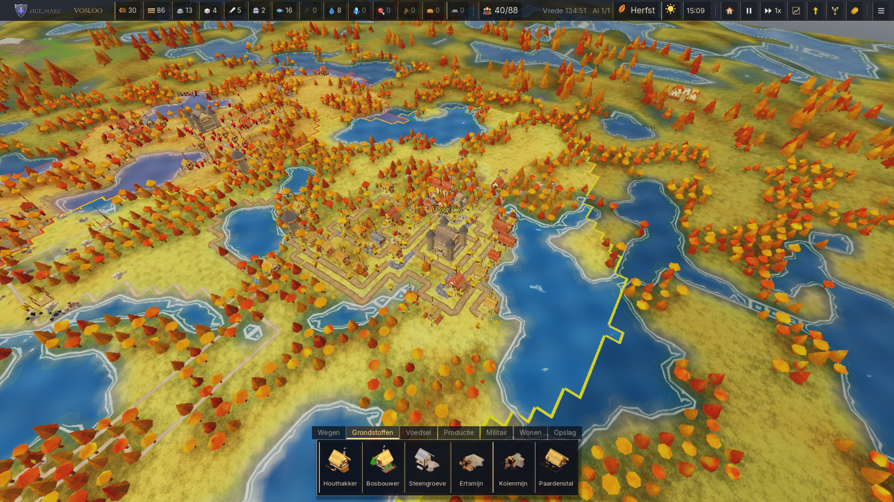
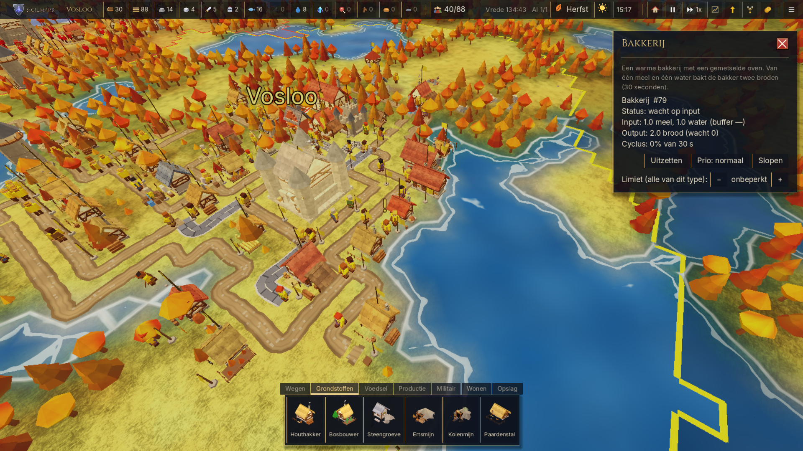
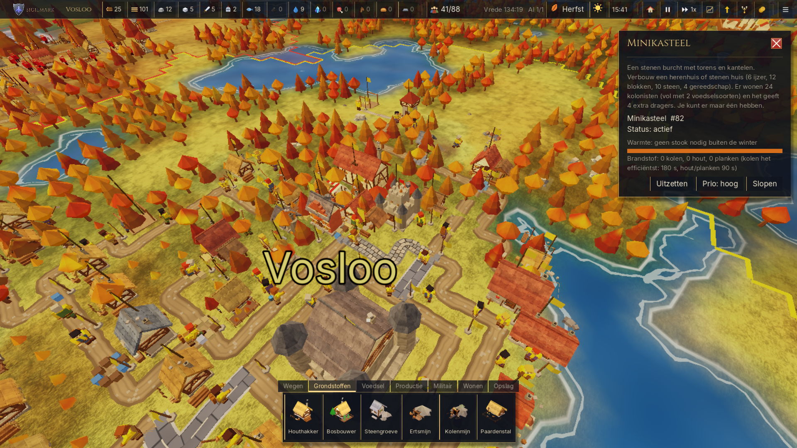
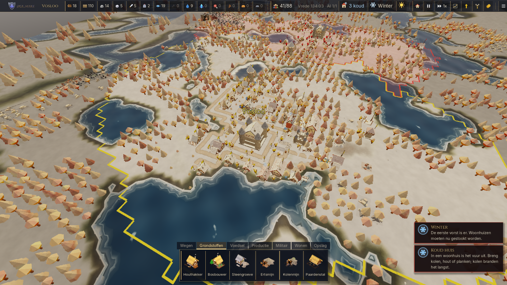

  

<h1 align="center">Sigilmark</h1>

  
  
  
  

> Sigilmark is een rustig maar scherp bouwspel. De Kroon van Ostrevaal is gebroken en het land is van niemand. Jij leidt Huis van de Eerste Kerf: leg wegen, bouw daken en merk je grenzen met het sigil. Ondertussen trotseer je rovers, rivaliserende huizen en winters die tanden hebben. *Eerst een dak, dan een droom.*

**Sigilmark** (tot versie 0.19.1.1 *Kolonie*) is een trage, ketengebaseerde economie- en bouwgame in de geest van *De Kolonisten (Die Siedler)*, gemaakt in Godot 4 door LTGnetwork (België). Gratis te downloaden voor Windows.

**[⬇ Download de nieuwste versie](https://github.com/LTGmaster/kolonie-releases/releases/latest)** · [Wat is er nieuw](CHANGELOG.md) · [Roadmap](ROADMAP.md) · [English](#english)

---

## De wereld
Toen de Kroon van Ostrevaal brak, viel het rijk uiteen in de **Wijde Marken**: woeste grond waar wie durft te merken, mag blijven. Het **sigil**, gekerfd in grenspalen en torens, houdt een gebied vast. Maar het houdt alleen stand zolang er een ridder binnen zit. Diep onder de grond zingt het **etherkristal**: kostbaar, krachtig en de oorzaak van de **Etherkou**, die de winters hier meedogenloos maakt.

## De volkeren
- **Huis van de Eerste Kerf**: jouw volk. Ze zijn nuchter en volhardend en bouwen eerst een dak, dan pas een droom.
- **Huis Brandaert**: volgens de overlevering trots en uit op uitbreiding.
- **Huis Ysselmont**: in de verhalen van oudsher verbonden met de rivieren en de handel.
- **Huis Wilgerode**: een stil huis met wortels in de bossen, zo wil de legende.
- **De Splinterbroeders**: rovers die vanuit hun kampen plunderen wat onbewaakt blijft.
- **Halverkade**: een neutrale handelsstad waar iedereen welkom is, zolang de vrede duurt.

*De volkeren zijn achtergrondverhaal. In het spel spelen de rivaliserende huizen allemaal met dezelfde regels als jij; hun speelstijl hangt af van het gekozen AI-niveau (Makkelijk, Normaal, Moeilijk), niet van hun naam.*

## Hoe je speelt
Je kolonisten doen het werk; jij legt de lijnen. Verbind je gebouwen met wegen, laat goederen stromen en breid je grens uit met grens- en militaire gebouwen. Houd je huizen warm in de winter, vind etherkristal, verken rivieren, stuur schepen uit en sta sterk tegen rovers en rivaliserende huizen. Hieronder zie je wat het spel allemaal te bieden heeft.

## Kenmerken (tot en met 0.21.5.1)
- **Kolonisten en dragers**: elk goed wordt echt gedragen, van vlag tot vlag. Dragers en depots houden je logistiek draaiende.
- **Wegen**: zonder weg kan het ook, maar wegen (aarde → kasseien → verhard) maken je dragers flink sneller.
- **Voedsel- en broodketen**: visser, jager, boerderij → molen → bakkerij, varkensboerderij → slager, en brouwerij voor bier. Huizen met meer voedselsoorten huisvesten meer kolonisten.
- **Metaal**: ertsmijn en kolenmijn, houtskoolbrander, smelterij en smederij voor gereedschap en zwaarden.
- **Paard en kar**: paardenstal en wagenmakerij; paarden maken je dragers sneller.
- **Woningen verbouwen**: huis → rijhuis of stenen huis → herenhuis → minikasteel, met eigen eisen voor voedsel, bier en stook.
- **Seizoenen en winter**: de winter heeft tanden; houd je huizen warm met hout of kolen.
- **Rivieren, overstromingen en dijken**, **schepen** en **handel** met de neutrale stad Halverkade.
- **Techboom**: onderzoek productie, economie, scheepvaart, ridders, …
- **AI-tegenstanders** (Makkelijk, Normaal, Moeilijk) met dezelfde regels als jij, en **roverskampen**.
- **Wilde dieren**, automatisch opslaan, quicksave/quickload, en het spel in het **Nederlands en Engels**.
- **Ingebouwde updater** en een "Wat is er nieuw"-scherm dat de nieuwste wijzigingen online ophaalt.

## Screenshots
| | |
|---|---|
|  |  |
| *Een groeiende stad in de herfst* | *De bakkerij: meel en water worden brood* |
|  |  |
| *Minikasteel (0.21.5)* | *Winter: houd je huizen warm* |

Oudere beelden: [wilde dieren](docs/screenshot_dieren191.png), [schepen](docs/screenshot_schepen12.png), [roverskampen](docs/screenshot_rovers174.png).

## Downloaden en installeren
1. Ga naar de [nieuwste release](https://github.com/LTGmaster/kolonie-releases/releases/latest) en download `Sigilmark-x.y.z-Setup.exe`.
2. Start de Setup en volg de stappen. Een nieuwe versie installeer je gewoon over de oude heen; je saves blijven bewaard.
3. **Bijwerken**: het spel zoekt bij het starten zelf naar een nieuwe versie en biedt die aan in het hoofdmenu of het pauzemenu. Je kunt ook altijd de nieuwste Setup downloaden en over de oude installeren.
4. **Windows SmartScreen**: de installer is (nog) niet digitaal ondertekend, dus Windows kan "Windows heeft uw pc beschermd" tonen. Klik op *Meer info* → *Toch uitvoeren*. Download Sigilmark alleen via deze pagina.

### Systeemvereisten
- Windows 10 of 11 (64-bit)
- Een videokaart met Vulkan-ondersteuning (de meeste kaarten van de laatste jaren)
- Draait ook op laptops met een **geïntegreerde GPU** (Intel/AMD): kies dan het profiel **Laag** (Instellingen → Grafische kwaliteit) en eventueel een FPS-limiet
- Ongeveer 500 MB vrije schijfruimte
- Toetsenbord en muis

## Besturing
| Actie | Toets |
|---|---|
| Camera schuiven / draaien | WASD of pijltjes / Q en E |
| Camera draaien en kantelen | middelste of rechtermuisknop slepen |
| Zoomen | muiswiel |
| Gebouw plaatsen | knop kiezen, linkermuisknop (groen = mag) |
| Vlagrichting draaien | T |
| Weg bouwen | R |
| Vlag zetten | F |
| Slopen | X |
| Annuleren | Esc of korte rechtermuisklik |
| Pauze / snelheid 1×, 2×, 4× | spatie / 1, 2, 3 |
| Quicksave / quickload | F5 / F9 |
| Hoofdmenu | M |

## Feedback en problemen melden
Bug gevonden of een idee? Open een [issue](https://github.com/LTGmaster/kolonie-releases/issues). Voeg bij voorkeur je versienummer en, bij een crash, de logbestanden toe uit
`%APPDATA%\Ltgnetwork\Kolonie\logs\` (de map heet nog Kolonie; plak dat pad in de Verkenner). Een save uit de map `saves` helpt ook.

## Roadmap
Wat er nog komt (missies en campagne, multiplayer-server, tutorial, …): zie [ROADMAP.md](ROADMAP.md). Alle wijzigingen per versie staan in [CHANGELOG.md](CHANGELOG.md).

## Credits en licentie
- Ontwerp en ontwikkeling: **Mike Van der bruggen / LTGnetwork** (België)
- Engine: [Godot Engine](https://godotengine.org) (MIT)
- 3D-modellen en texturen: eigen werk, [Kenney](https://kenney.nl) en [Poly Haven](https://polyhaven.com) — CC0 1.0
- Lettertypen: **Inter** en **Cinzel** (logo) — SIL Open Font License 1.1

© 2026 LTGnetwork. Alle rechten voorbehouden. Sigilmark is gratis te downloaden en te spelen voor persoonlijk gebruik; verspreiden, aanpassen of commercieel gebruik mag niet zonder schriftelijke toestemming van LTGnetwork. Externe assets behouden hun eigen licentie. Zie [LICENSE](LICENSE).

---

## English
**Sigilmark** (called *Kolonie* up to 0.19.1.1) is a calm but sharp, chain-based colony builder inspired by *The Settlers*, made in Godot 4 by LTGnetwork (Belgium). Free for Windows.

The Crown of Ostrevaal is broken and the land belongs to no one. Lead the House of the First Notch: lay roads, raise roofs and mark your borders with the sigil — while facing bandits, rival houses and winters with teeth. *First a roof, then a dream.*

**Features (up to 0.21.5.1):** settlers and carriers with depot logistics · roads as a speed bonus · food and bread chain (farm → mill → bakery, pigs → butcher, brewery) · metal (mines, charcoal, smelter, smithy) · horses and carts · house upgrades (terraced house, stone house, manor, mini castle) · seasons and harsh winters · rivers, floods, dikes and ships · trade with the neutral town · tech tree · AI opponents and bandit camps · wild animals · in-game updater · Dutch and English.

**Install & update:** download `Sigilmark-x.y.z-Setup.exe` from the [latest release](https://github.com/LTGmaster/kolonie-releases/releases/latest) and run it. New versions install over the old one (saves are kept); the game also offers updates itself. If SmartScreen warns (unsigned installer), click *More info* → *Run anyway*.

**Requirements:** Windows 10/11 64-bit, a Vulkan-capable GPU. Runs on laptops with integrated graphics using the **Low** profile. Roadmap: [ROADMAP.md](ROADMAP.md) · Changes: [CHANGELOG.md](CHANGELOG.md).

**Feedback:** open an [issue](https://github.com/LTGmaster/kolonie-releases/issues); attach logs from `%APPDATA%\Ltgnetwork\Kolonie\logs\` if possible.

© 2026 LTGnetwork. All rights reserved. Free to download and play for personal use; no redistribution, modification or commercial use without written permission. Third-party assets keep their own licenses (CC0 / OFL). See [LICENSE](LICENSE).
